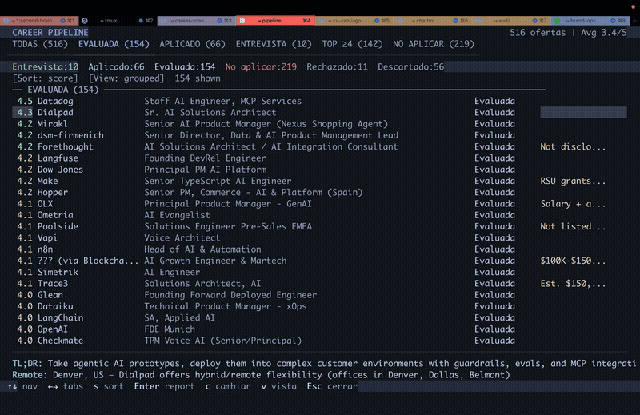

# Career-Ops

[English](README.md) | [Español](README.es.md) | [Português (Brasil)](README.pt-BR.md) | [한국어](README.ko-KR.md) | [日本語](README.ja.md) | [Русский](README.ru.md) | [繁體中文](README.zh-TW.md)

<p align="center">
  <a href="https://x.com/santifer"></a>
</p>

<p align="center">
  <em>I spent months applying to jobs the hard way. So I engineered the system I wish I had.</em><br>
  Companies use AI to filter candidates. <strong>I gave candidates AI to <em>choose</em> companies.</strong><br>
  <em>Now it's open source.</em>
</p>

<p align="center">
  
  
  
  
  
  
  
  
  <a href="https://discord.gg/8pRpHETxa4"></a>
</p>

---

<p align="center">
  
</p>

<p align="center"><strong>740+ job listings evaluated · 100+ personalized CVs · 1 dream role landed</strong></p>

## What Is This

Career-Ops turns an AI coding CLI into a full job search command center. Instead of manually tracking applications in a spreadsheet, you get an AI-powered pipeline that:

- **Evaluates offers** with a structured A-F scoring system (plus legitimacy block G)
- **Generates tailored PDFs** — ATS-optimized CVs customized per job description
- **Scans portals** automatically (Greenhouse, Ashby, Lever, company pages)
- **Processes in batch** via a provider-neutral execution adapter
- **Tracks everything** in a single source of truth with integrity checks

> Important: This is NOT a spray-and-pray tool. Career-Ops is a filter — it helps you find the few offers worth your time out of hundreds. The system strongly recommends against applying to anything scoring below 4.0/5. Always review before submitting.

OpenAI/Codex is now the primary documented path. Claude support still exists where available. Both paths reuse the same modes, templates, scripts, tracker flow, report generation, PDF generation, and scanner behavior.

## OpenAI-first architecture

- Canonical agent instructions live in `CAREER_OPS_AGENT.md`
- `AGENTS.md` is the primary Codex/OpenAI wrapper
- `CLAUDE.md` is now a thin Claude wrapper
- Batch execution goes through `scripts/run-agent.mjs`
- `CAREER_OPS_PROVIDER` selects `codex`, `openai`, or `claude`

No parallel second system was introduced. The domain workflow is unchanged.

## Quick Start

```bash
# 1. Clone and install
git clone https://github.com/santifer/career-ops.git
cd career-ops
npm install
npx playwright install chromium

# 2. Configure
cp config/profile.example.yml config/profile.yml
cp templates/portals.example.yml portals.yml
# create cv.md with your CV in markdown

# 3. Check setup
CAREER_OPS_PROVIDER=codex npm run doctor

# 4. Open your preferred agent runtime
codex
# Claude users can still run: claude
```

Then ask the agent to adapt the system to you, for example:
- "Change the archetypes to backend engineering roles"
- "Translate the modes to English"
- "Add these 5 companies to portals.yml"
- "Update my profile with this CV I'm pasting"

## Usage

Career-Ops is a single slash-command-style workflow with multiple modes:

```
/career-ops                → Show all available commands
/career-ops {paste a JD}   → Full auto-pipeline (evaluate + PDF + tracker)
/career-ops scan           → Scan portals for new offers
/career-ops pdf            → Generate ATS-optimized CV
/career-ops batch          → Batch evaluate multiple offers
/career-ops tracker        → View application status
/career-ops apply          → Fill application forms with AI
/career-ops pipeline       → Process pending URLs
/career-ops contacto       → LinkedIn outreach message
/career-ops deep           → Deep company research
/career-ops training       → Evaluate a course/cert
/career-ops project        → Evaluate a portfolio project
```

Or just paste a job URL or description directly — Career-Ops auto-detects it and runs the full pipeline.

## Batch execution

Batch mode now runs through the provider-neutral adapter:

```bash
./batch/batch-runner.sh --provider codex
./batch/batch-runner.sh --provider openai
./batch/batch-runner.sh --provider claude
```

The tracker TSV flow, report naming, PDF contract, merge logic, retries, resume behavior, and logs are unchanged.

## Project structure

```
career-ops/
├── CAREER_OPS_AGENT.md         # Canonical provider-neutral instructions
├── AGENTS.md                   # Primary Codex/OpenAI wrapper
├── CLAUDE.md                   # Thin Claude wrapper
├── cv.md                       # Your CV (create this)
├── config/profile.example.yml  # Template for your profile
├── modes/                      # Shared mode files
├── templates/                  # CV template + states + portal config template
├── scripts/run-agent.mjs       # Provider-neutral batch adapter
├── batch/                      # Batch runner, prompt, state, logs, TSV additions
├── dashboard/                  # Go TUI pipeline viewer
├── data/                       # Tracking data
├── reports/                    # Evaluation reports
└── output/                     # Generated PDFs
```

## Tech stack

- Agent runtime: Codex/OpenAI first, Claude supported
- PDF: Playwright + HTML template
- Scanner: Playwright + portal APIs + direct HTTP
- Dashboard: Go + Bubble Tea + Lipgloss
- Data: Markdown tables + YAML config + TSV batch files

## Docs

- `docs/SETUP.md` — setup and onboarding
- `docs/CODEX.md` — Codex/OpenAI usage
- `docs/ARCHITECTURE.md` — system design and execution model
- `batch/README.md` — batch processing, provider selection, resumability

## Disclaimer

Career-Ops is a local, open-source tool — not a hosted service. Your CV, contact info, and personal data stay on your machine and are sent directly to the AI provider you choose. Always review generated materials before submitting.
