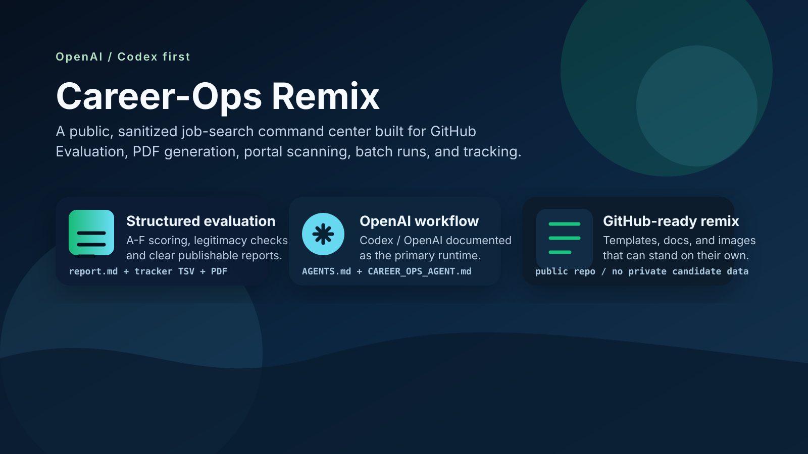

# Career-Ops Remix



OpenAI/Codex-first job-search command center.

This repository is a public remix of the original Career-Ops project. It keeps the same workflow pattern - evaluation, PDF generation, tracker updates, portal scanning, and batch processing - but removes personal CV data, private role history, and private proof points so it can serve as a clean template.

## What It Does

- Evaluates job descriptions with a structured A-F score plus a posting-legitimacy check
- Generates ATS-friendly PDFs from a markdown CV
- Scans portals and company career pages for new roles
- Tracks applications, follow-ups, and pipeline state in plain text files
- Runs through the same checked-in modes and scripts for Codex/OpenAI and other supported runtimes

## OpenAI-First Path

- `AGENTS.md` is the Codex/OpenAI wrapper
- `CAREER_OPS_AGENT.md` is the canonical instruction file
- `CLAUDE.md` remains a thin compatibility wrapper
- Batch execution goes through `scripts/run-agent.mjs`

## Repository Promise

- No personal candidate history is shipped in the shared docs
- User-specific content stays in `cv.md`, `config/profile.yml`, `modes/_profile.md`, `article-digest.md`, and `portals.yml`
- The project is structured so it can be published directly on GitHub as a public template

## Quick Start

```bash
git clone https://github.com/SillyAllen86/career-ops-remix.git
cd career-ops-remix
npm install
npx playwright install chromium
npm run doctor
```

Then edit these files to make the system yours:

- `config/profile.yml`
- `modes/_profile.md`
- `cv.md`
- `article-digest.md`
- `portals.yml`

## Project Layout

- `modes/` - shared mode files
- `templates/` - CV and workflow templates
- `scripts/` - orchestration helpers
- `batch/` - batch processing and resume support
- `dashboard/` - terminal UI for tracking
- `data/` - application and follow-up trackers
- `reports/` - evaluation reports
- `output/` - generated PDFs and HTML artefacts
- `docs/` - setup, architecture, publishing, and image assets

## Visuals


The repo also includes a shareable Open Graph image in `docs/og-image.svg`.

## Remix Notes

- Original project: Career-Ops upstream
- This remix is intentionally generic and does not ship with the maintainer's personal career history
- The intent is to show the workflow, not a private candidate profile

## GitHub Publishing

If you want to publish this repo, start with `docs/PUBLISH.md`. It explains the placeholder URLs that should be replaced before going public and the assets to keep in the README.

## License

MIT
