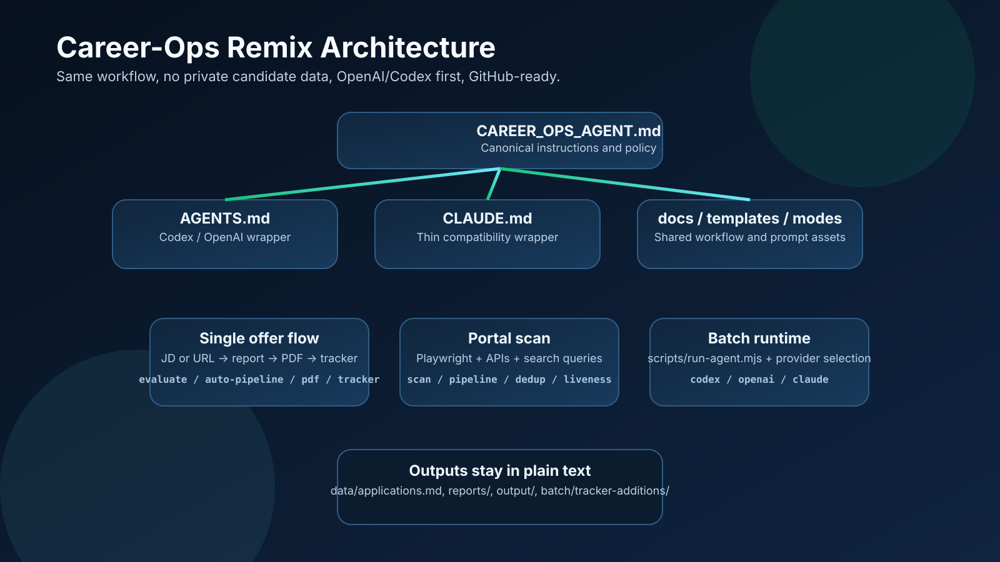

# Architecture



## System overview

```
                ┌──────────────────────────────────────┐
                │  Canonical instructions              │
                │  CAREER_OPS_AGENT.md                │
                └───────────────┬──────────────────────┘
                                │
              ┌─────────────────┴─────────────────┐
              │                                   │
      ┌───────▼────────┐                  ┌───────▼────────┐
      │ AGENTS.md      │                  │ CLAUDE.md      │
      │ Codex/OpenAI   │                  │ Claude wrapper │
      └───────┬────────┘                  └───────┬────────┘
              │                                   │
              └───────────────┬───────────────────┘
                              │
                    ┌─────────▼─────────┐
                    │ Shared modes      │
                    │ modes/*.md        │
                    └───────┬───────────┘
                            │
        ┌───────────────────┼────────────────────┐
        │                   │                    │
 ┌──────▼──────┐    ┌───────▼───────┐    ┌──────▼────────────┐
 │ Single eval │    │ Portal scan   │    │ Batch orchestrator │
 │ auto-pipe   │    │ scan.md       │    │ batch-runner.sh    │
 └──────┬──────┘    └───────┬───────┘    └────────┬──────────┘
        │                   │                     │
        │            ┌──────▼──────┐       ┌──────▼──────────┐
        │            │ pipeline.md │       │ scripts/run-    │
        │            │ URL inbox   │       │ agent.mjs       │
        │            └─────────────┘       └──────┬──────────┘
        │                                          │
        └──────────────────────┬───────────────────┘
                               │
                ┌──────────────▼─────────────────────────────┐
                │ Output pipeline                            │
                │ report .md + PDF + tracker TSV + merge     │
                └──────────────┬─────────────────────────────┘
                               │
                      ┌────────▼────────┐
                      │ applications.md │
                      │ canonical tracker│
                      └─────────────────┘
```

## What changed in the refactor

The domain workflow did not change. The refactor only changed the execution layer:

- Shared agent rules moved to `CAREER_OPS_AGENT.md`
- `AGENTS.md` became the primary Codex/OpenAI wrapper
- `CLAUDE.md` became a thin Claude wrapper
- Batch execution now goes through `scripts/run-agent.mjs`
- `CAREER_OPS_PROVIDER` selects `codex`, `openai`, or `claude`

This keeps business logic, files, report generation, tracker flow, PDF generation, and scanning behavior intact.

## Public remix contract

The public remix intentionally keeps three boundaries:

- Shared system files describe behavior and routing
- User-layer files hold any customization
- Generated outputs and reports stay out of the public template by default

## Evaluation flow (single offer)

1. Input: user pastes JD text or URL
2. Extract: browser automation / page fetch extracts the JD
3. Classify: detect archetype
4. Evaluate: blocks A-G
5. Score: weighted 1-5 global score
6. Report: save `reports/{num}-{company}-{date}.md`
7. PDF: generate ATS-optimized CV via `generate-pdf.mjs`
8. Track: write TSV to `batch/tracker-additions/` and merge

## Batch processing

```
batch-input.tsv -> batch-runner.sh -> scripts/run-agent.mjs -> provider runtime
(id, url, ...)     orchestration       adapter                codex/openai/claude
```

The batch runner still handles:
- pending/completed/failed state in `batch-state.tsv`
- resumability
- retry counts
- per-offer logs
- report numbering
- tracker merge + verification at the end

`scripts/run-agent.mjs` is intentionally thin. It selects the runtime and forwards the resolved prompt plus task instruction. It does not introduce a second workflow.

## Data flow

```
cv.md                       -> evaluation context
article-digest.md           -> proof points
config/profile.yml          -> candidate identity + targeting
portals.yml                 -> scanner configuration
templates/states.yml        -> canonical statuses
templates/cv-template.html  -> PDF generation template
```

## File naming conventions

- Reports: `{###}-{company-slug}-{YYYY-MM-DD}.md`
- PDFs: `cv-candidate-{company-slug}-{YYYY-MM-DD}.pdf`
- Tracker TSVs: `batch/tracker-additions/{id}.tsv`

These contracts were preserved.

## Integrity scripts

- `merge-tracker.mjs` — merge TSV additions into `data/applications.md`
- `verify-pipeline.mjs` — health checks for duplicates, links, and statuses
- `dedup-tracker.mjs` — remove duplicate tracker entries
- `normalize-statuses.mjs` — normalize status aliases
- `cv-sync-check.mjs` — config / CV consistency checks
